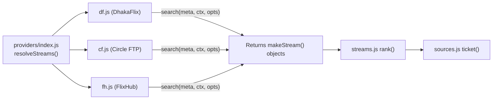

> **Status (Nov 2026): superseded.** This was the pre-implementation plan. Live measurements changed several of its
> assumptions: Fendrix is called **directly** from the browser (its API sends CORS headers), not through the edge proxy,
> and its hosts were removed from `EDGE_PROXY_HOSTS`; its HLS plays only through built-in HLS; Hexion's link chain now
> runs through other domains and needed a documented deviation. The current design, deviations and test evidence are
> in `docs/IMPLEMENTATION.md` section 6 and `VERIFICATION.md` sections 5 and 18.

# Fendrix + Hexion Provider Integration Plan

## Analysis Summary

### Fendrix (Cinejoy / Shegu API)
| Property | Detail |
|---|---|
| **Source site** | `cinejoy.pk` (public HTTPS) |
| **API endpoints** | `api.shegu.xyz` (encrypted session broker), `api.wing.st` / `api.shegu.st` (stream endpoints) — all **public HTTPS** |
| **Servers** | Two named servers: `"Nebula"` and `"Secret"` |
| **Stream type** | **HLS** (master playlist → variant streams) or **direct file** (MP4 URLs with quality keys) |
| **Encryption** | The API responses are **AES-256-GCM encrypted**. A session is created via `enc-dec.app/api/enc-cinejoy` which returns a response key + AAD. The encrypted payload from the stream endpoint is then decrypted client-side |
| **Qualities** | 2160p, 1080p, Auto — only 2160p and 1080p are kept |
| **Subtitles** | The API returns subtitle tracks (`captions` array) with each stream item |
| **Auth/Headers** | Requires `Origin: https://cinejoy.pk`, `Referer: https://cinejoy.pk/`, custom UA |
| **TMDB call** | Makes its own TMDB call to get title/year/IMDb ID |
| **Transport** | All endpoints are **public HTTPS** — reachable from both browser and Cloudflare edge |

### Hexion (4kHdHub)
| Property | Detail |
|---|---|
| **Source site** | `4khdhub.one` (public HTTPS, WordPress-based) |
| **API** | HTML scraping — search via `/wp-json/wp/v2/posts` and `/?s=` search, then follow redirect chains through HubCloud/HubDrive |
| **Stream hosts** | `*.r2.cloudflarestorage.com`, `*.r2.dev`, `cdn.fsl-buckets.life` (FSL-v2), and PixelDrain — all **public HTTPS** |
| **Stream type** | **Direct file download** (MP4/MKV from R2/PixelDrain) |
| **Encryption** | Link unwrapping: multi-layer base64 + ROT13 decoding to extract the real download URL from HubCloud pages |
| **Qualities** | 2160p, 1080p, 720p (480p filtered out) |
| **Metadata** | Rich: file size, bitrate, language, HDR/DV, audio codecs, source (Blu-ray/WEB-DL/WEB-Rip), IMAX, REMUX |
| **Auth/Headers** | Mobile UA for session, desktop UA for playback, `Referer: https://4khdhub.one/` |
| **TMDB call** | Makes its own TMDB call |
| **Transport** | All endpoints are **public HTTPS** — reachable from both browser and Cloudflare edge |

> [!IMPORTANT]
> **Key architectural difference from existing BDIX providers**: Both Fendrix and Hexion use **public HTTPS endpoints only**. They do NOT need the BDIX gateway. They CAN be fetched server-side via the edge proxy, or even directly from the browser (if CORS allows), or via the gateway if one is configured.

## How Existing Reelhouse Providers Work

**Provider contract** — each provider exports:
- `id` — unique string (e.g. `'bdix-df'`)
- `name` — display name
- `search(meta, ctx, opts)` — returns `makeStream()` objects
- Optional: `edge: true` if the edge proxy should be used
- `meta` has: `{type, tmdbId, title, year, season?, episode?}`
- `ctx` has: `ctx.text(url, init)`, `ctx.json(url, init)` — instrumented fetch wrappers that count successes/failures

**`makeStream()`** returns: `{id, provider, providerName, url, quality, height, container, filename, info, headers}`
- `info` from `describe()`: `{video, audio, source, hdr, dv, tenBit, imax, codecLabel, audioLabel, langs}`

## Integration Plan

### Files to Create
| File | Purpose |
|---|---|
| `public/js/providers/fn.js` | Fendrix provider (Cinejoy/Shegu) |
| `public/js/providers/hx.js` | Hexion provider (4kHdHub) |

### Files to Modify
| File | Change |
|---|---|
| `public/js/providers/index.js` | Import and register both new providers |
| `public/js/providers/common.js` | No changes needed — `makeStream()` and `describe()` already support all needed metadata |
| `public/js/store.js` | Add new provider IDs to `DEFAULT_SETTINGS.providers` |
| `public/js/streams.js` | Add new provider IDs to `PROVIDER_ORDER` |
| `public/js/ui/settings.js` | Automatically picks up new providers from `PROVIDERS` array — **no change needed** |
| `public/js/ui/sources.js` | Automatically picks up new providers from `PROVIDERS` array — **no change needed** |
| `lib/api.js` | Add `cinejoy.pk`, `api.shegu.xyz`, `api.shegu.st`, `api.wing.st`, `enc-dec.app`, `4khdhub.one`, `pixeldrain.com`, `*.r2.cloudflarestorage.com`, `*.r2.dev`, `cdn.fsl-buckets.life` to `EDGE_PROXY_HOSTS` allow-list |
| `HANDOFF.md` | Add Fendrix/Hexion to file map |
| `CLAUDE.md` | Add provider entries |
| `docs/IMPLEMENTATION.md` | Document new providers in section 6 |

### Design Decisions

1. **No TMDB call in provider** — Reelhouse already has the title, year, and IMDb ID from TMDB details. The watch page passes `meta` with all this info. The original scrapers make redundant TMDB calls; we skip them (same pattern as existing df/cf/fh providers).

2. **Transport**: Both providers use public HTTPS. We'll mark them `edge: true` so the edge proxy (`/api/proxy`) is used when no gateway is configured — same pattern as FlixHub. Need to add their hosts to `EDGE_PROXY_HOSTS`.

3. **Fendrix encryption**: The AES-GCM decryption must happen client-side (the scraper includes a full software AES-GCM implementation). In the browser we can use the native `SubtleCrypto` API instead, which is vastly more efficient. But the encryption session is created via `enc-dec.app` — this is a third-party proxy endpoint. We need to proxy this through the edge, or call it directly (it's public HTTPS, may have CORS).

4. **Fendrix subtitles**: The scraper returns subtitle tracks with each stream. We'll convert these into the format the existing subtitle system uses, or attach them to the stream object for display.

5. **Hexion HTML parsing**: Uses a custom tag-scanner in the original. In the browser we have `DOMParser` (same approach as FlixHub). Will use the same `opts.DOMParser` pattern.

6. **Hexion link unwrapping**: Multi-step: find HubCloud link → fetch it → decode base64+ROT13 → get real URL. Each step needs an HTTP fetch. All are public HTTPS.

7. **Provider IDs**: `fendrix` and `hexion` (short, consistent with existing scheme of lowercase IDs).

8. **Stream details display**: Both providers have rich metadata. We'll use `describe()` from `common.js` for filename-based info, plus add provider-specific display data (file size, bitrate, host name for Hexion; server name for Fendrix).

### Step-by-Step Execution

**Phase 1: Create the providers**
1. Create `public/js/providers/fn.js` (Fendrix)
2. Create `public/js/providers/hx.js` (Hexion)

**Phase 2: Wire them in**
3. Update `providers/index.js` — add imports and registration
4. Update `store.js` — add to DEFAULT_SETTINGS.providers
5. Update `streams.js` — add to PROVIDER_ORDER
6. Update `lib/api.js` — extend EDGE_PROXY_HOSTS

**Phase 3: Verify**
7. Visual inspection of provider code
8. Manual logic trace
9. Update documentation

### What Cannot Be Verified Without Network
- Real API responses from `cinejoy.pk`, `api.shegu.xyz`, `enc-dec.app`, `4khdhub.one`
- CORS headers on those endpoints
- AES-GCM decryption with real encrypted payloads
- HubCloud redirect chain resolution
- Real stream playback from R2/PixelDrain/Shegu endpoints
